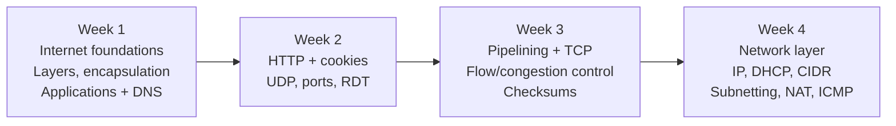
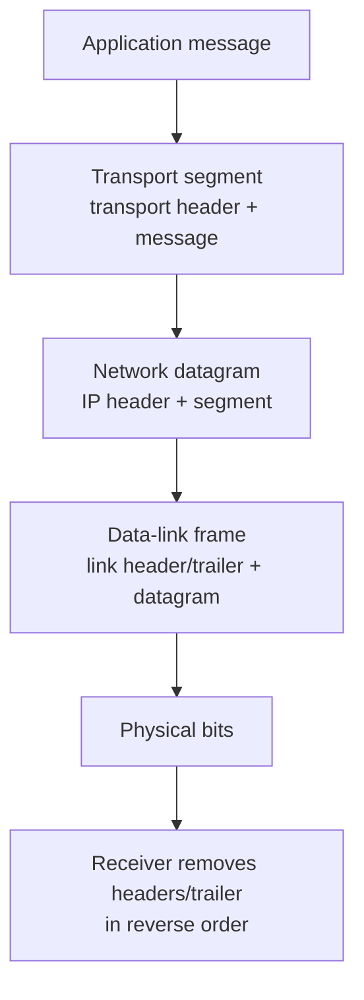
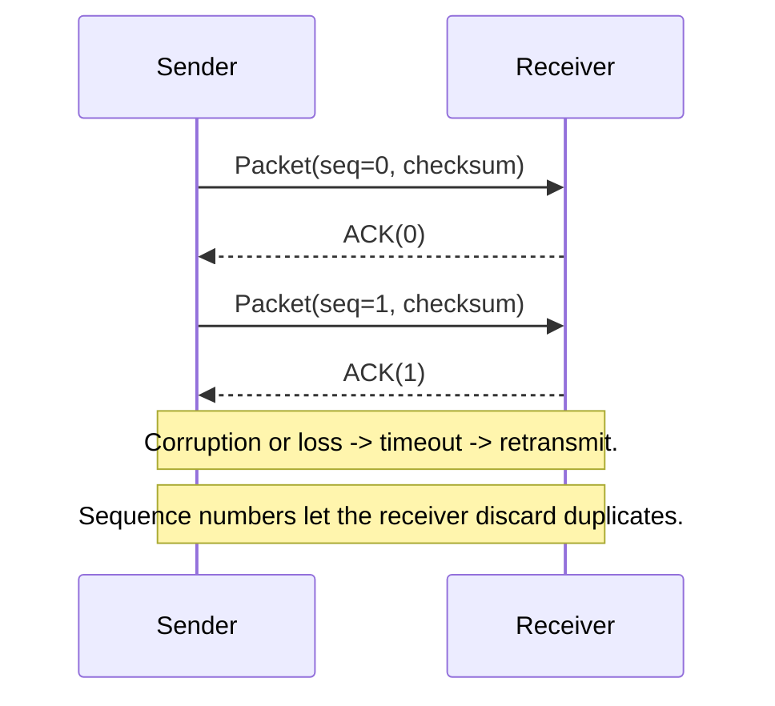
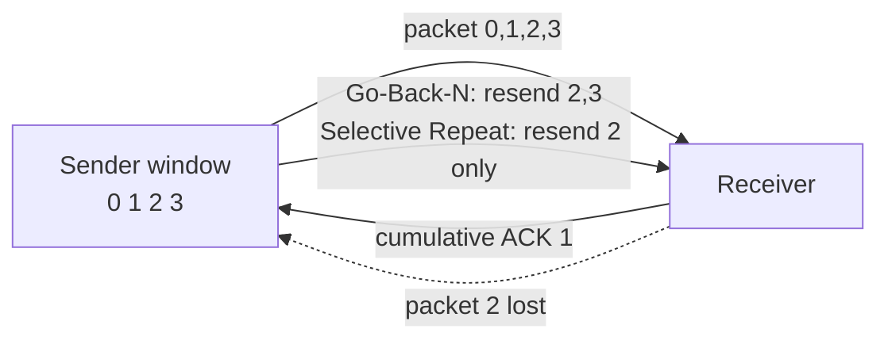
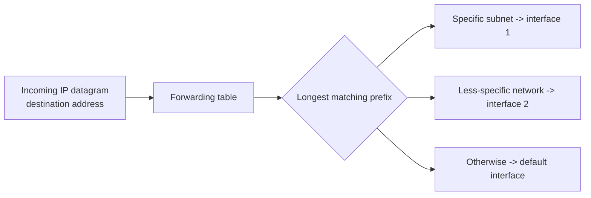
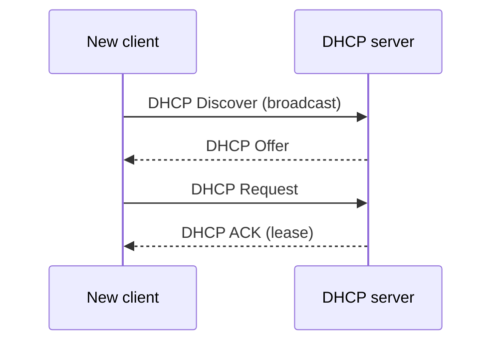
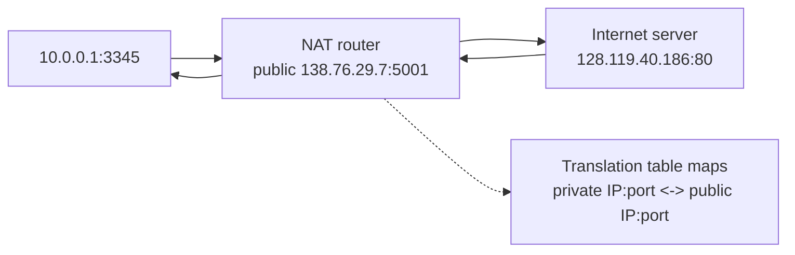
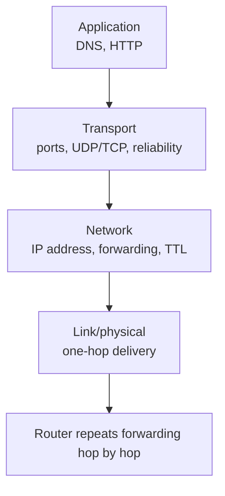

# EEEN30111 Data Networking - Weeks 1-4

Concise study notes based on the supplied lecture PDFs and the corresponding [Canvas modules](https://canvas.manchester.ac.uk/courses/88120/modules).

## Course arc

## Week 1 - Internet foundations and application layer

Canvas: [Introduction - Week 1](https://canvas.manchester.ac.uk/courses/88120/pages/introduction-week-1) and [Summary - Week 1](https://canvas.manchester.ac.uk/courses/88120/pages/summary-week-1).

### Core concepts

- **Internet building blocks:** end systems/hosts, communication links, routers, access networks, ISPs, and protocols. Link transmission rate is the link bandwidth.
- **Protocols** define the format and order of messages and the actions taken when messages are sent or received. Examples include TCP/IP, HTTP, and FTP.
- **Circuit switching:** reserves resources for a call. FDM divides frequency; TDM divides time. Reserved capacity can sit idle.
- **Packet switching:** splits a data stream into packets, shares link capacity statistically, and forwards packets hop by hop using store-and-forward. Queues form when offered load exceeds available capacity.
- **Why packet switching scales:** bursty users rarely transmit at their peak rate simultaneously, so statistical multiplexing can support more users than fixed reservations, at the cost of variable delay and possible loss.

### Five-layer model

| Layer | Main service | Examples / PDU |
|---|---|---|
| Application | Network applications and messages | HTTP, FTP, SMTP, DNS / message |
| Transport | Process-to-process delivery | TCP, UDP / segment |
| Network | Routing datagrams host to host | IP / datagram |
| Data link | Delivery between neighbouring network elements | Ethernet, Wi-Fi, PPP / frame |
| Physical | Bits/signals on the medium | copper, fibre, radio / bits |

Layering makes a complex system modular: a layer can change its implementation while preserving its service interface to the layers above and below.

### Encapsulation

At a router, the network-layer header is inspected and the packet is re-encapsulated in a new link-layer frame for the next hop. A router does not normally run the user's application.

### Creating network applications

- Applications run on end systems and communicate through **sockets**, the process's interface to the transport layer.
- A socket is addressed using an IP address plus a port number. Common server ports include HTTP 80 and mail 25.
- **Client-server:** an often-on server with a stable address serves clients that may connect intermittently.
- **Peer-to-peer:** peers can act as both clients and servers, distributing resources without a single central service.

### DNS

- DNS maps names to IP addresses using a distributed, hierarchical database rather than one central server.
- A typical resolution follows: local DNS resolver -> root server -> top-level-domain server -> authoritative server.
- Caching reduces repeated queries and lookup delay. DNS is an application-layer service, normally carried over transport protocols.

## Week 2 - HTTP, cookies, UDP, and reliable data transfer

Canvas: [Introduction - Week 2](https://canvas.manchester.ac.uk/courses/88120/pages/introduction-week-2) and [Summary - Week 2](https://canvas.manchester.ac.uk/courses/88120/pages/summary-week-2).

### HTTP

- HTTP is the Web's application-layer protocol. A browser is the client; a Web server returns objects such as HTML, images, and JavaScript.
- The classic course model uses TCP: the client opens a TCP connection to the server, exchanges HTTP messages, then closes or keeps the connection alive.
- HTTP is **stateless**: the server does not inherently retain earlier request information.
- A request contains a request line, headers, a blank line, and optionally a body. Example methods: `GET` retrieves a resource; `POST` sends data.
- A response contains a status line, headers, a blank line, and an optional body. `200 OK` indicates success; headers describe metadata such as content type and length.

### Cookies and user-server state

The course identifies four components:

1. A `Set-Cookie` header in the HTTP response.
2. A `Cookie` header in later HTTP requests.
3. A cookie file managed by the browser.
4. A back-end database at the website.

Together these let a stateless HTTP service maintain sessions, preferences, or shopping-cart state.

### Transport vs network layer

- **Network layer:** logical communication between hosts; moves datagrams across routers.
- **Transport layer:** logical communication between processes; uses ports and adds services such as reliability, flow control, and congestion control.
- Transport PDUs are **segments**. Multiplexing gathers data from many sockets at the sender; demultiplexing delivers received segments to the correct socket.
- UDP demultiplexing mainly uses the destination port. A TCP socket is identified by a four-tuple: source IP, source port, destination IP, destination port.

### UDP

- UDP is connectionless: no handshake and no connection state at the endpoints.
- Segments may be lost or delivered out of order; UDP does not retransmit or notify the application of loss.
- Its small header and lack of connection setup make it useful where low overhead, speed, or loss tolerance matters.
- A UDP segment includes source port, destination port, length, checksum, and application data.
- The checksum detects bit errors; it does not provide recovery.

### Reliable data transfer (RDT)

An unreliable channel can corrupt or lose data. A reliable protocol combines:

- **Checksum:** detect corrupted bits.
- **ACK/NAK:** report success or failure.
- **Sequence numbers:** distinguish a new packet from a duplicate retransmission.
- **Timeouts:** retransmit when an ACK does not arrive in a reasonable time, including the round-trip time and processing delay.

Stop-and-wait is simple but inefficient on long-delay links because the sender waits after every packet. Pipelining sends multiple unacknowledged packets to increase link utilisation.

## Week 3 - Pipelining, TCP, congestion, and checksums

Canvas: [Introduction - Week 3](https://canvas.manchester.ac.uk/courses/88120/pages/introduction-week-3) and [Summary - Week 3](https://canvas.manchester.ac.uk/courses/88120/pages/summary-week-3).

### Pipelined ARQ

- A sender can keep a window of several in-flight packets, increasing throughput when propagation delay is large.
- **Go-Back-N:** cumulative ACKs confirm all packets through sequence number `n`; an out-of-order packet is discarded; a timeout retransmits the missing packet and later packets in the window.
- **Selective Repeat:** retransmits only the packets that remain unacknowledged; it needs more receiver buffering and bookkeeping.

### TCP

- TCP builds a reliable service on top of IP's best-effort, unreliable service.
- It provides a point-to-point, full-duplex, in-order **byte stream**. It does not preserve application message boundaries.
- TCP is connection-oriented and uses a three-way handshake: `SYN` -> `SYN + ACK` -> `ACK`.
- TCP sequence numbers count bytes. An ACK number is the next byte expected, not simply the next segment number.
- TCP uses a receive buffer and advertises `RcvWindow`; this gives **flow control**, preventing the sender from overflowing the receiver.
- TCP's sending window is also shaped by congestion control. A connection closes using `FIN` and `ACK` control segments.

### Flow control vs congestion control

- **Flow control:** protects one receiver from a sender that is transmitting faster than the application can read.
- **Congestion control:** protects the shared network from too many sources sending too much data too quickly.
- Congestion appears as queueing delay and packet loss from overflowing router buffers.
- TCP uses end-to-end feedback, inferring congestion from loss and delay. The course presents additive increase, multiplicative decrease: grow the window to probe for capacity, then reduce it sharply after congestion.

### Internet checksum

- Used by IP, TCP, and UDP as an error-detecting code.
- Set the checksum field to zero, add 16-bit words using one's-complement addition with end-around carry, then complement the result.
- The receiver adds the received words, including the checksum. An all-ones result means the check passes; it does not guarantee that every possible error was detected.

## Week 4 - Network layer, IP, DHCP, subnetting, NAT, and ICMP

Canvas: [Introduction - Week 4](https://canvas.manchester.ac.uk/courses/88120/pages/introduction-week-4) and [Summary - Week 4](https://canvas.manchester.ac.uk/courses/88120/pages/summary-week-4).

### Forwarding and routing

- **Forwarding** is the local action of moving a packet from an input interface to the correct output interface.
- **Routing** computes the path from source to destination using routing algorithms and protocols.
- A forwarding table aggregates destination ranges rather than listing every IP address.
- **Longest-prefix matching:** when multiple entries match a destination, use the entry with the longest matching address prefix.

### IP and the network layer

- IP encapsulates a transport segment into a datagram. Hosts and routers process the IP header; routers forward based on destination address.
- The IPv4 header includes source and destination addresses, total length, TTL, upper-layer protocol identifier, fragmentation fields, and a header checksum.
- TTL is decremented at each router; expiry prevents a packet from circulating forever.
- The network-layer stack also includes routing protocols such as RIP, OSPF, and BGP, plus ICMP for errors and signalling.

### IPv4 addressing and CIDR

- An IPv4 address is 32 bits and is associated with an interface, not necessarily an entire device. Routers usually have multiple interfaces.
- A subnet is a group of interfaces with the same subnet portion that can communicate directly without an intervening router.
- CIDR uses `a.b.c.d/x`, where `x` is the number of network-prefix bits. The remaining bits identify hosts within that block.
- A subnet mask extracts the network/subnet portion. For `/28`, the mask is `255.255.255.240`; the router can compute the subnet by bitwise AND with the address.
- Address allocation is hierarchical: global authorities allocate blocks to registries and ISPs, which subdivide them for customers. Hierarchy lets the outside world advertise an aggregate route.

### DHCP

DHCP dynamically assigns an address and configuration when a host joins a network. The basic exchange is:

DHCP can also supply the first-hop router, DNS server, subnet mask, and lease lifetime. The course example uses UDP ports 68 (client) and 67 (server).

### Subnetting

- Subnetting extends the prefix into the host part to create smaller internal networks.
- For a `/23` split into `/28` subnets, 5 host bits become subnet bits: 32 subnets, with 16 addresses per subnet and typically 14 usable host addresses after reserving all-zero and all-one host values.
- Example: `200.23.16.44` with a `/28` mask belongs to `200.23.16.32/28`, because the mask keeps the first 28 bits and clears the last four.

### Classful and private addressing

- Classful addressing used fixed A, B, and C boundaries, but it wasted address space and did not scale well.
- Private IPv4 ranges from the course are `10.0.0.0/8`, `172.16.0.0/12`, and `192.168.0.0/16`.
- Private addresses are not globally routed. They allow address reuse across separate local networks and reduce demand for public addresses.

### NAT

NAT replaces each outgoing `(private source IP, source port)` with `(public NAT IP, new port)` and records the mapping. Replies use the public tuple; the NAT router translates them back to the internal host. Benefits include public-address conservation, internal renumbering without external changes, and reduced direct visibility of internal hosts.

### ICMP

- ICMP is carried inside IP datagrams and provides network-level error reporting and control.
- It reports conditions such as destination/network/port unreachable, bad IP header, and TTL expired.
- `ping` uses ICMP echo request and echo reply to test reachability and estimate round-trip latency.

## Cross-week mental model

1. Applications create messages and hand them to a socket.
2. Transport identifies the destination process and may add reliability, ordering, flow control, and congestion control.
3. IP addresses the destination host/interface and routers forward the datagram hop by hop.
4. Each link carries a frame to the next hop; encapsulation changes at every hop, while the IP destination remains the end destination.

## Quick revision checklist

- Explain circuit switching, packet switching, statistical multiplexing, and store-and-forward.
- Draw the five-layer model and label each protocol data unit.
- Explain sockets, ports, DNS hierarchy, HTTP request/response, and cookie state.
- Contrast TCP and UDP, including what UDP does not guarantee.
- Explain checksum, ACK/NAK, sequence numbers, timeout, ARQ, Go-Back-N, and Selective Repeat.
- Describe TCP's three-way handshake, byte sequence numbers, receive window, and FIN closure.
- Distinguish flow control from congestion control.
- Apply longest-prefix matching and subnet-mask ANDing.
- Explain DHCP Discover/Offer/Request/ACK and what configuration it supplies.
- Calculate the rough size and usable hosts of a CIDR subnet.
- Explain private addresses, NAT translation tables, and ICMP diagnostics.
