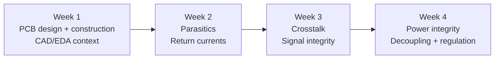
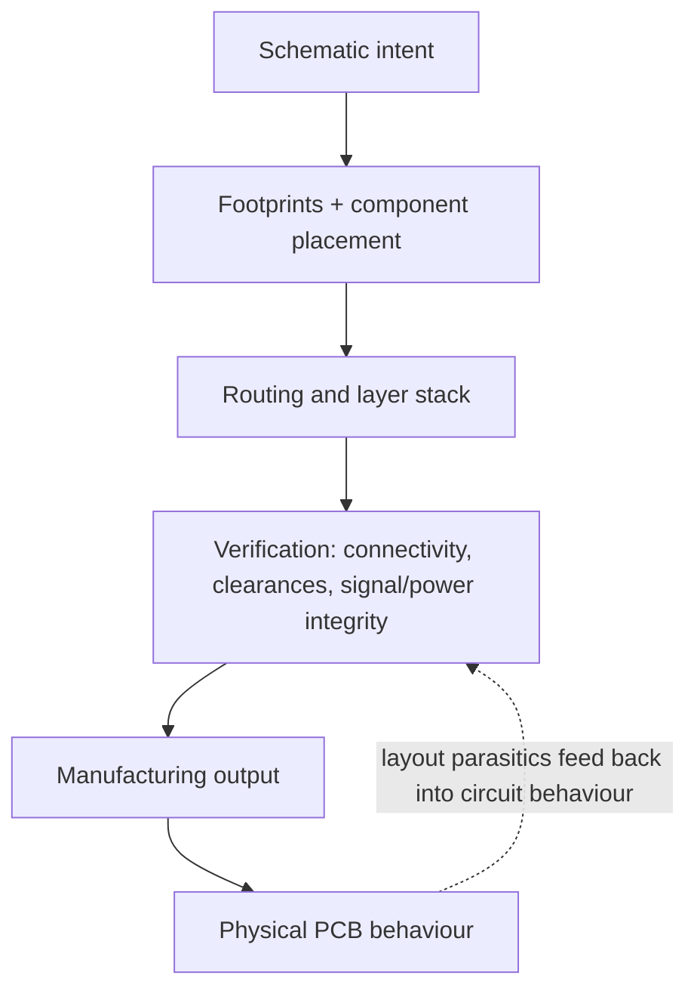
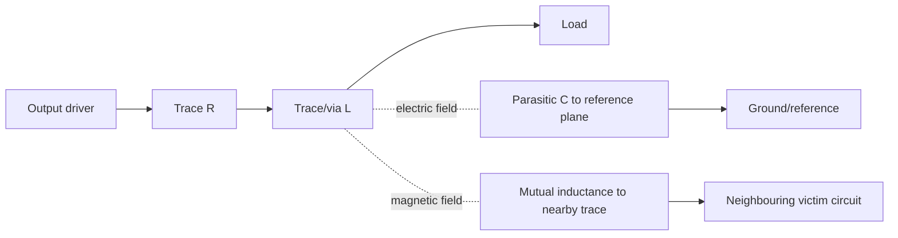
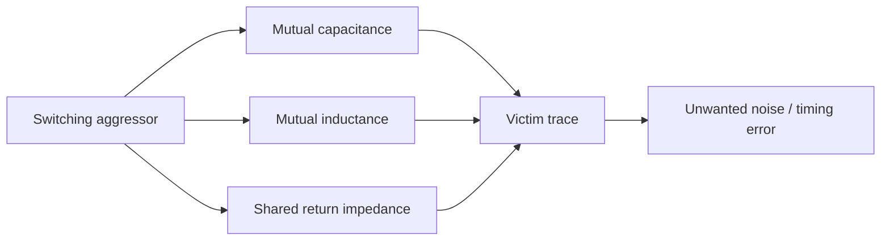
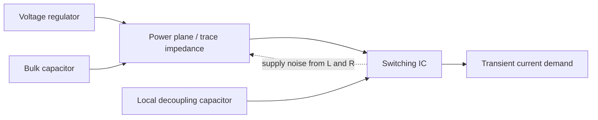
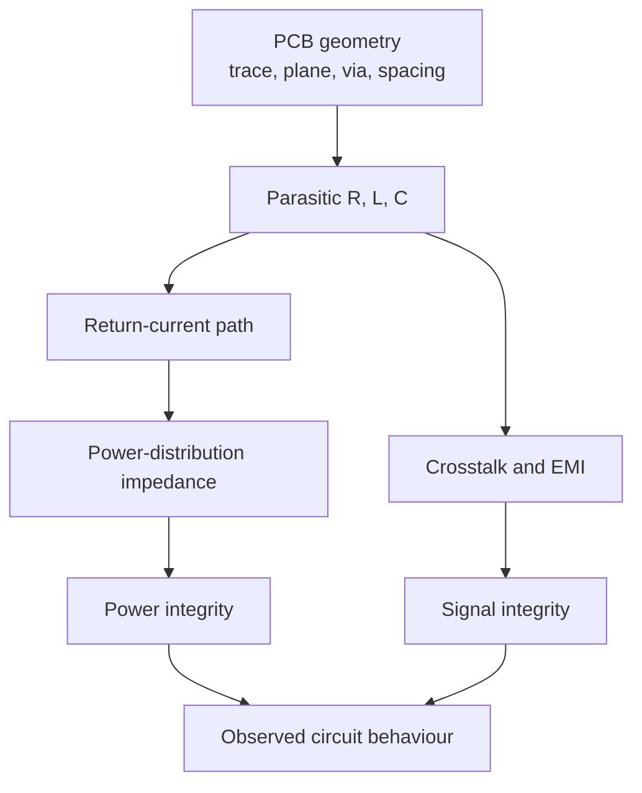

# EEEN30171 High Speed Digital and Mixed Signal Design - Weeks 1-4

Concise notes based on the [Canvas course modules](https://canvas.manchester.ac.uk/courses/87860/modules). The first four weeks build a single idea: PCB geometry and power distribution are part of the circuit, especially as signal edges become faster.

## Course arc

## Week 1 - PCB design and construction

Canvas: [Introduction - Week 1](https://canvas.manchester.ac.uk/courses/87860/pages/introduction-week-1).

### Why this unit matters

- PCB design sits inside the wider electronic product design process: circuit intent must become a manufacturable physical implementation.
- A circuit's behaviour depends on both **connectivity** and **layout**. The same schematic can behave differently when trace length, layer stack, return paths, and component placement change.
- The unit uses CAD/EDA tools such as Altium Designer. The aim is to understand board-level design principles; tool operation is supported through private study and lab work.
- High-speed behaviour can initially look surprising if a board is treated as ideal wires. Later topics explain these effects using resistance, capacitance, inductance, fields, and transmission-line behaviour.

### PCB construction concepts

- A PCB is a layered physical structure containing conductive copper, insulating dielectric material, component connections, and mechanical support.
- **Signal layers** carry traces. **Power and ground layers** distribute supply voltage and provide low-impedance return paths.
- Important design primitives include pads, vias, tracks/traces, planes, clearances, component footprints, and layer stack geometry.
- A good layout makes current paths short and predictable, preserves manufacturability, and leaves a controlled return path for every important signal.

### Design mindset

Ask two questions for every interconnect:

1. Where does the signal current flow?
2. Where does the return current flow?

If the return path is long, discontinuous, or forced through a narrow connection, the loop area and impedance increase. That makes the design more sensitive to noise, ringing, EMI, and crosstalk.

## Week 2 - Parasitics and return currents

Canvas: [Introduction - Week 2](https://canvas.manchester.ac.uk/courses/87860/pages/introduction-week-2).

### What are parasitics?

Real PCB features have unwanted but unavoidable electrical properties:

- **Parasitic resistance (R):** trace, via, plane, and connector resistance causes voltage drop and heating.
- **Parasitic capacitance (C):** electric-field coupling between a trace and nearby conductors stores charge and slows or reshapes edges.
- **Parasitic inductance (L):** current flowing through a physical loop creates magnetic energy and voltage proportional to `L * di/dt`.
- A trace is therefore not an ideal wire; its length, width, spacing, reference plane, and neighbouring conductors matter.

### Return currents

- Current always forms a loop: outgoing signal current plus return current.
- At low frequency, resistance strongly influences how current divides between possible return paths.
- At higher frequency, inductance and loop area become more important. Return current tends to follow the path of lowest impedance, often close to the signal trace on an adjacent reference plane.
- A continuous ground plane provides a wide, low-inductance return path. Slots, gaps, splits, and unnecessary layer changes can force return current to detour.
- Self-inductance describes a conductor's opposition to changes in its own current. Mutual inductance describes magnetic coupling between nearby current loops.

### Practical consequences

- Shorter routes, smaller loop areas, close reference planes, and well-placed vias generally reduce unwanted inductance.
- Do not reason only from voltage waveforms; inspect the current path and the fields around it.
- PCB layout is part of the circuit model: changing geometry changes the parasitic R, L, and C.

## Week 3 - Crosstalk and signal integrity

Canvas: [Introduction - Week 3](https://canvas.manchester.ac.uk/courses/87860/pages/introduction-week-3).

### Definition

**Crosstalk** is unwanted coupling from an aggressor circuit into a nearby victim circuit. It can appear as a voltage transient, timing error, overshoot, or false logic transition.

### Main coupling mechanisms

- **Mutual capacitance:** a changing aggressor voltage drives displacement current into the victim. Faster voltage transitions produce stronger coupling.
- **Mutual inductance:** a changing aggressor current induces voltage in the victim. Shorter rise time means larger `di/dt` and usually stronger coupling.
- **Shared impedance:** two circuits share part of a return path or supply path. Current from one circuit creates a voltage drop that appears in the other.
- Electric-field coupling is associated with capacitance; magnetic-field coupling is associated with inductance.

### Frequency and edge-rate intuition

- Crosstalk is driven by **edge rate**, not only by the repetition frequency of a digital signal.
- A fast edge contains higher-frequency content, so the same physical spacing can be safe for a slow signal but problematic for a fast one.
- Mutual-reactance coupling generally increases as rise time decreases.
- Shared-impedance coupling can matter even at relatively low frequencies because it depends on common resistance or impedance in the return path.

### Reduction strategies

- Increase spacing between aggressor and victim traces.
- Reduce parallel run length.
- Route over a continuous reference plane and keep the return path close.
- Reduce loop area and avoid unnecessary discontinuities.
- Slow the edge when system timing permits; lower `di/dt` and `dv/dt` reduce coupling.
- Avoid sharing narrow return paths between high-current or fast-switching circuits.

## Week 4 - Power integrity

Canvas: [Introduction - Week 4](https://canvas.manchester.ac.uk/courses/87860/pages/introduction-week-4).

### Signal integrity vs power integrity

- **Signal integrity:** whether a digital signal retains its intended waveform and timing.
- **Power integrity:** whether the PCB power and ground arrangement maintains stable voltages while the circuit draws changing current.
- Power integrity becomes difficult at high frequency and during synchronous switching, when many outputs change state nearly simultaneously.

### Why the supply cannot respond instantly

When a load switches, it may need a rapid current transient. The remote power supply and PCB distribution network have finite resistance and inductance, so they cannot provide the current instantaneously without a local energy source.

The supply disturbance can be viewed through impedance:

`V_noise = I_transient * Z_power-distribution`

Lowering the power-distribution impedance reduces voltage disturbance.

### Decoupling and distribution

- Place a local decoupling capacitor close to the device power pins so it can supply fast transient current through a small loop.
- A capacitor's effectiveness is limited by its equivalent series resistance and, especially at high frequency, its equivalent series inductance and mounting geometry.
- One capacitor value is not ideal across every frequency. Combinations of capacitors can provide lower impedance over a wider frequency range.
- Use short, wide connections and a low-inductance power/ground arrangement. Via placement and plane geometry are part of the capacitor loop.
- Bulk capacitance supports slower or larger energy changes; small local capacitors support faster edges.

### Voltage regulators

- Regulators establish the nominal supply voltage and respond to slower load changes.
- Local capacitors bridge the gap between a fast load transient and the regulator's response.
- Regulator choice, output impedance, stability requirements, capacitor characteristics, and PCB placement must be considered together.

## Cross-week mental model

The key lesson is that a schematic describes intended connectivity, but high-speed behaviour depends on the physical electromagnetic structure that implements it.

## Quick revision checklist

- Explain why PCB layout is part of the circuit, not just a drawing of connections.
- Identify the parasitic R, L, and C associated with a trace, via, plane, or connector.
- Draw the signal-current loop and its return path.
- Explain why a continuous ground plane usually improves return-current behaviour.
- Distinguish self-inductance, mutual inductance, mutual capacitance, and shared impedance.
- Define aggressor, victim, and crosstalk.
- Explain why faster rise time increases high-frequency coupling.
- Describe three practical ways to reduce crosstalk.
- Distinguish signal integrity from power integrity.
- Explain why local decoupling capacitors help during fast load transients.
- Explain why capacitor combinations and low-inductance layout matter.
